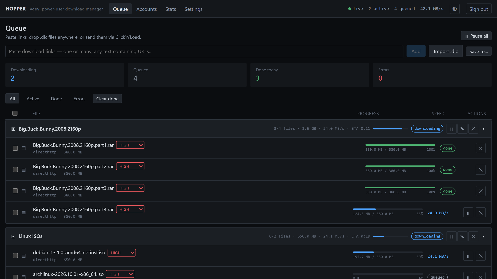

<div align="center">


# hopper

**Privacy-first download manager for power users and homelab.**

[](https://github.com/simuuh/hopper-downloader/actions/workflows/ci.yml)
[](docs/INSTALL.md)
[](LICENSE)
[](docs/INSTALL.md#security-model)



</div>

Hopper is a download manager for one-click hosters that runs on your NAS
or server and is used from the browser. It understands Click'n'Load and
DLC like JDownloader, but is built to run headless from the start:

- **A real web UI, no desktop app.** One container (or one Go binary) —
  no Java, no VNC-in-the-browser, no cloud relay to reach it remotely.
- **Nothing to install on your PC.** Click'n'Load from hoster sites goes
  to your NAS through a browser extension.
- **Debrid-first.** One account at Real-Debrid, AllDebrid, Debrid-Link
  or Premiumize.me covers most hosters; native plugins exist for
  Rapidgator, 1fichier, Katfile and DDownload.
- **Private.** No telemetry, no phone-home, hoster credentials encrypted
  at rest.

## Features

- Click'n'Load 2 (filecrypt.cc, hide.cx, …) and `.dlc` / `.txt` import
- Links grouped into one package per release; later parts merge in,
  duplicates and mirrors are skipped
- Parallel, chunked, resumable downloads with automatic retries and
  live-adjustable bandwidth limits
- Auto-extract (RAR incl. multi-part and password lists, ZIP, tar)
- Several debrid services with a priority order — if the first can't
  serve a link, the next one takes it
- Several accounts per hoster with automatic rotation when one runs out
- Push notification when a package is finished (webhook, ntfy)
- Share links from your phone to Hopper
- Dark and light theme, works on phones; finished view, editable links,
  stats; REST API with OpenAPI spec, CLI client

## Quickstart

No git checkout, no secrets to prepare:

```sh
mkdir hopper && cd hopper
curl -fsSLO https://raw.githubusercontent.com/simuuh/hopper-downloader/main/docker-compose.yml
curl -fsSLo .env https://raw.githubusercontent.com/simuuh/hopper-downloader/main/.env.example
nano .env                          # PUID/PGID, downloads folder, ports
docker compose up -d
docker compose logs hopperd        # first start: prints the admin password
```

Open `http://<host>:9667` and sign in as `admin`. All settings live in
`.env`, the compose file stays untouched; update with
`docker compose pull && docker compose up -d`. Details, building from
source and configuration: [docs/INSTALL.md](docs/INSTALL.md).

## Getting links in

| From | How |
|---|---|
| The Web UI | Paste any text with links, or drop `.dlc` / `.txt` files on the page |
| Hoster sites (Click'n'Load) | Install the [browser extension](docs/REMOTE_CLICKNLOAD.md) (or `hopperctl` on your PC) |
| Your phone | Share the link to Hopper ([how](docs/USAGE.md#from-a-phone)) |
| Scripts | `POST /api/v1/links/bulk` ([API](docs/API.md)) |

## Documentation

| | |
|---|---|
| [INSTALL.md](docs/INSTALL.md) | Docker, from source, configuration, security model |
| [USAGE.md](docs/USAGE.md) | Adding links, phone sharing, packages, accounts, notifications |
| [REMOTE_CLICKNLOAD.md](docs/REMOTE_CLICKNLOAD.md) | Click'n'Load with hopperd on a NAS: extension and hopperctl |
| [API.md](docs/API.md) | REST API overview ([OpenAPI spec](api/openapi.yaml)) |
| [COMPATIBILITY.md](docs/COMPATIBILITY.md) | Tested sites and hosters, known limitations |
| [TROUBLESHOOTING.md](docs/TROUBLESHOOTING.md) | Symptoms and fixes |
| [ARCHITECTURE.md](docs/ARCHITECTURE.md) | How it's built and why |
| [PLUGIN_GUIDE.md](docs/PLUGIN_GUIDE.md) | Writing a hoster plugin |
| [CONTRIBUTING.md](CONTRIBUTING.md) | Development (`make check` runs everything CI runs) |
| [SECURITY.md](SECURITY.md) | Reporting security issues |

## What Hopper deliberately doesn't do

Captcha-solving services, router reconnects, plugins for hundreds of
hosters and video sites, multiple users. If you need those, JDownloader
is the better tool. Hopper stays small: a debrid account plus a few
native plugins, run headless and reliably.

Sorting finished downloads into a movie/series library isn't Hopper's job
either — point [Folder Mover](https://github.com/simuuh/folder-mover) at
Hopper's downloads directory for that, or hand the folder from the
package-finished webhook to your own tooling.

## Legal

Hopper is a general-purpose download manager. It does not host, index,
link to or provide any content. You are responsible for only downloading
files you have the right to download, and for complying with the terms
of the services you use.

## License

[MIT](LICENSE)
